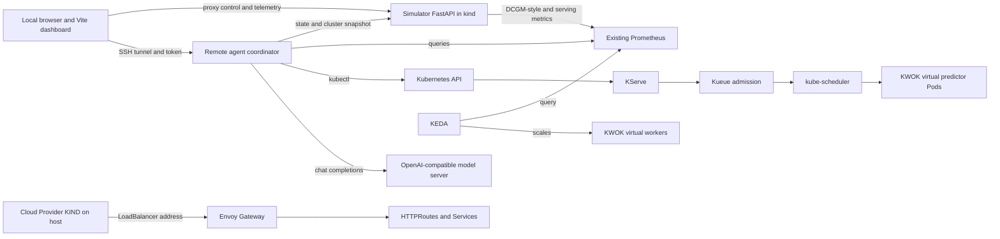
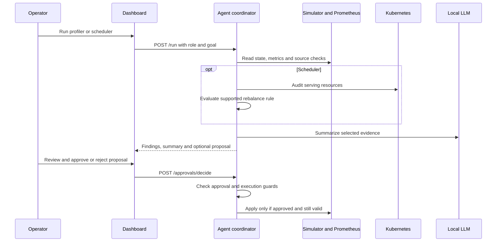

# GPU simulator architecture

## Current deployment

The remote kind cluster runs one real simulator Deployment on the kind control-plane node, Kubernetes control-plane components, KWOK, KEDA and serving controllers. It uses an existing Prometheus service outside this deployment. Virtual nodes represent the selected GPU inventory, and KWOK simulates their Pods. The coordinator currently runs as a separate host process, not as a Kubernetes agent Pod. The Vite/D3 dashboard runs separately and proxies configured simulator, Prometheus and coordinator endpoints. In the demonstrated lab, SSH forwards a local port to the remote loopback coordinator.

The simulator exposes its control API on 8080, DCGM-style metrics on 9400 and serving metrics on 8002. The model server location is independently configured; in the demonstrated lab LM Studio runs on the dashboard computer and listens for the remote coordinator. [operator-runbook.md](operator-runbook.md) describes setup, trust boundaries and exact commands.

## Component responsibilities

| Component | Responsibility |
|---|---|
| `src/gpu_sim/simulator.py` | Workload arrivals, fixed inventory, TP groups, request lifecycle, analytical capacity and simulated faults. |
| `src/gpu_sim/main.py`, `metrics.py` | FastAPI control, one simulation loop, state and synthetic metrics. |
| `src/gpu_sim/cluster.py` | Read-only Kubernetes snapshot through the in-cluster service account, including cluster-wide Pod requests for inventory. |
| `src/gpu_sim/analytics/` | Prometheus queries, scope and freshness checks, deterministic diagnoses and benchmark classification. |
| `src/gpu_sim/agents.py` | LangGraph workflows, approval gate, action execution, benchmark orchestration and advisory LLM summaries. |
| `src/gpu_sim/serving_scheduler.py` | Context-scoped `kubectl` reads and approved KServe fixture submission. |
| `ui/` | Configuration, metrics and cluster views, agent controls, approvals and summaries. |
| `deploy/`, `scripts/`, `docker/` | kind/KWOK/KEDA and serving manifests, installation scripts and image build files. |

## Control and approval flow

The coordinator uses an operator bearer token. A scheduler run first collects profiler evidence; if deterministic checks justify a supported rebalance, it creates a pending proposal. A benchmark request creates a plan with explicit rates and hold time. A KServe request creates a planned InferenceService. No agent proposal executes until the operator approves it; rejection records a decision. The coordinator checks the approved baseline before applicable execution and serializes execution within its single process. Benchmark execution temporarily changes offered load and attempts to restore the original workload, reporting whether verification succeeded.

Records and execution locks are in process memory, so one coordinator process is assumed. Restarting it loses pending approvals and history; they are not stored in Postgres or RustFS. The LLM produces advisory prose from selected evidence; it does not operate Kubernetes or bypass approval. Neither one process nor in-memory state provides durable audit or cross-process coordination.

## KServe and Kueue path

The serving installer configures `gpu-serving`, an associated LocalQueue and ClusterQueue, and a KWOK resource flavor with CPU, memory and GPU quotas. An approved RawDeployment InferenceService produces a predictor Pod labeled for the queue. Kueue can hold the Pod using an admission gate until quota is available; kube-scheduler binds it after admission, subject to node capacity and constraints. KServe-created HTTPRoutes attach to an Envoy Gateway. Cloud Provider KIND supplies a LoadBalancer address; the demonstrated setup disables its Gateway controller to avoid a Gateway API CRD version mismatch.

The KServe path has been exercised with virtual Pods, including quota contention and release. Routes accepted by Envoy and KWOK Ready status do not establish a real HTTP inference service. See [design.md](design.md) and [next-steps.md](next-steps.md) for implementation details and limits.

## Agent interactions with the application

All three roles run as workflows in the same remote coordinator process. They are not three Kubernetes Pods or independent always-running services. The dashboard invokes the coordinator through the authenticated `/api/agent` proxy; the coordinator communicates with simulator state, Prometheus and, for serving audits/submissions, the Kubernetes API via `kubectl`. The optional model server receives selected structured evidence and returns summary prose; it does not receive authority to mutate those systems.

Profiler is the common evidence step. Scheduler adds a deterministic rule and optional serving audit; the KServe proposal is also available through the dashboard's separate service controls. Benchmark uses its own plan/execution flow: a plan captures baseline and exact rates, and approval triggers a long-running experiment that samples Prometheus and attempts workload restoration. Dashboard polling reports status/history; neither polling nor LLM text is a durable execution log. Model-server failure should leave deterministic outputs and approval decisions independent, though it can delay a response while the coordinator waits for its request timeout.

The Kubernetes inventory and serving data have different paths and permissions: the simulator's in-cluster service account reads cluster snapshots, while the host coordinator's kubeconfig reads KServe/Kueue/Gateway resources. An error in one view does not imply that the other is available. [dashboard.md](dashboard.md) documents each visible section and the operator interaction.
